# Vibix Images: полное руководство пользователя

Версия приложения: 3.1.0. Актуальность руководства: 30 августа 2026 года.

Это руководство проводит через весь рабочий процесс: от API-ключей и промптов до генерации клипартов, удаления фона, ручной корректировки прозрачности, Pinterest-изображений и обработки готовых файлов. Все примеры путей, ключей и изображений демонстрационные.

Содержание:

1. Что умеет приложение
2. Быстрый старт
3. API-ключи
4. Рабочие папки и результаты
5. Режим Clipart: полный процесс
6. Генератор промптов
7. CSV: формат и импорт
8. Проверка промптов
9. Chroma key: генерация на ключевом фоне
10. Модель, формат и число вариантов
11. Обработка клипартов
12. Проверка стоимости и запуск
13. Результаты и повторный запуск
14. Редактирование прозрачности
15. Режим Pinterest
16. Режим Processing
17. Практические сценарии
18. Типичные проблемы
19. Чек-лист перед большой серией
20. Официальные ссылки

## 1. Что умеет приложение

Vibix Images содержит три отдельных режима:

| Режим | Когда использовать | Результат |
| --- | --- | --- |
| **Создать клипарт** | Нужна серия изображений по промптам, с референсами или без них | Готовые изображения; при удалении фона — PNG с прозрачностью |
| **Создать Pinterest-пины** | Нужны вертикальные изображения 2:3 по готовому промпту или CSV | Набор Pinterest-изображений без публикации в Pinterest |
| **Обработать изображения** | Уже есть PNG, JPG или WEBP и нужно улучшить качество, удалить фон, края или метаданные | Новые обработанные файлы; исходники не перезаписываются по умолчанию |

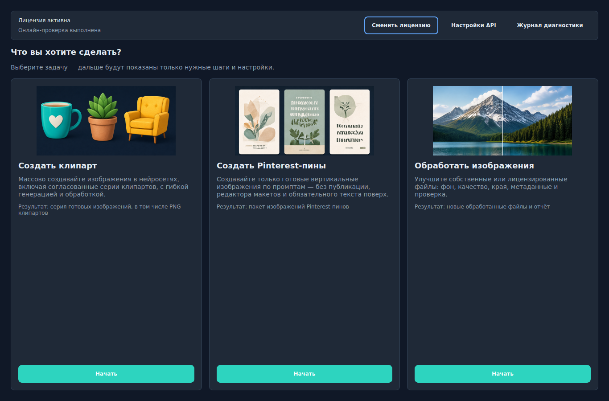

В верхней панели всегда доступны **Сменить режим**, **Настройки API** и **Диагностика**. Слева в рабочем режиме показаны этапы. Бирюзовая точка означает текущий этап, галочка — уже пройденный.

## 2. Быстрый старт

1. Установите и запустите Vibix Images.
2. Активируйте лицензию приложения.
3. Откройте **Настройки API** и добавьте ключи только тех сервисов, которыми будете пользоваться.
4. Для первого теста создайте отдельную рабочую папку и один промпт.
5. На экране **Проверка и запуск** внимательно проверьте число изображений, API-вызовов, стоимость, папку результата и порядок обработки.
6. Нажмите **Запустить**. Не закрывайте приложение до завершения очереди.
7. Проверьте готовые PNG на странице результатов. При необходимости откройте **Проверить прозрачность** и исправьте alpha-маску кистью.

Рекомендуется начинать с одного изображения и одного варианта. Это позволяет проверить ключ, модель, фон и качество края с минимальными расходами.

## 3. API-ключи

Ключи провайдеров не входят в лицензию Vibix Images. Аккаунт, баланс и оплата управляются отдельно на стороне каждого сервиса.

| Сервис | Для чего нужен | Где создать ключ |
| --- | --- | --- |
| KIE.AI | Поддерживаемые модели генерации, Topaz/Recraft и другие KIE-операции | [KIE API Key](https://kie.ai/api-key) |
| fal.ai | Поддерживаемые модели генерации, апскейла и удаления фона | [fal.ai API Keys](https://fal.ai/dashboard/keys) |
| PhotoRoom | Удаление фона через PhotoRoom | [PhotoRoom API Dashboard](https://app.photoroom.com/api-dashboard) |
| RunPod | Только отдельно настроенные Serverless-задачи | [RunPod Settings](https://www.runpod.io/console/user/settings) |

### 3.1 KIE.AI

1. Откройте [KIE.AI](https://kie.ai/login) и войдите или зарегистрируйтесь.
2. Перейдите в [API Key Management](https://kie.ai/api-key).
3. Создайте отдельный ключ с понятным именем, например `Vibix Images`.
4. При наличии лимитов задайте безопасный дневной или общий предел.
5. Пополните баланс и проверьте текущие цены на [странице KIE Pricing](https://kie.ai/pricing).
6. Скопируйте ключ. Не добавляйте к нему `Bearer`, кавычки или пробелы.

### 3.2 fal.ai

1. Откройте [fal.ai](https://fal.ai/login) и войдите через GitHub, Google или SSO.
2. Если у вас несколько команд, сначала выберите нужный личный или командный аккаунт.
3. Откройте [Dashboard → Keys](https://fal.ai/dashboard/keys) и нажмите **Create Key**.
4. Для вызова готовых моделей выберите область **API**. Область **ADMIN** приложению не требуется.
5. Скопируйте ключ сразу после создания: секретная часть повторно не показывается.
6. Цену конкретной модели проверяйте в [каталоге fal.ai](https://fal.ai/models) перед запуском серии.

### 3.3 PhotoRoom

1. На компьютере откройте [PhotoRoom API Dashboard](https://app.photoroom.com/api-dashboard).
2. Войдите или создайте аккаунт и команду, если кабинет предлагает этот шаг.
3. Включите новый API-ключ и выберите план, допускающий **Remove Background API**.
4. Скопируйте ключ и проверьте остаток запросов в API Dashboard.
5. Тариф API не равен обычной подписке редактора PhotoRoom. Актуальные условия смотрите на [странице API Pricing](https://www.photoroom.com/api/pricing).

### 3.4 RunPod

RunPod нужен только для заранее развёрнутого совместимого Serverless endpoint. Одного API-ключа без endpoint недостаточно.

1. Откройте [RunPod Settings → API Keys](https://docs.runpod.io/get-started/api-keys) и создайте отдельный ключ. По возможности используйте **Restricted** и дайте доступ только нужному Serverless endpoint.
2. В консоли откройте **Serverless**, разверните совместимый endpoint и дождитесь готовности.
3. Откройте страницу endpoint и скопируйте его уникальный **Endpoint ID**. Это идентификатор из адреса вида `https://api.runpod.ai/v2/ENDPOINT_ID/`, а не имя шаблона.
4. Пополните баланс и проверьте настройки масштабирования: постоянно работающие workers могут создавать расходы даже без новых заданий.
5. В Vibix Images заполните оба поля: **RunPod API Key** и **RunPod Endpoint ID**.

### 3.5 Как ввести ключи в Vibix Images

1. На главном экране или внутри рабочего режима нажмите **Настройки API**.
2. Вставьте ключ целиком в соответствующее поле. Символы скрыты — это нормально.
3. Нажмите **Проверить баланс** рядом с KIE, PhotoRoom или fal.ai. Проверка баланса не генерирует изображение.
4. Оставьте число одновременных задач равным `3`, если провайдер не требует более осторожного режима.
5. Нажмите **Save**. **Cancel** закрывает окно без сохранения новых значений.

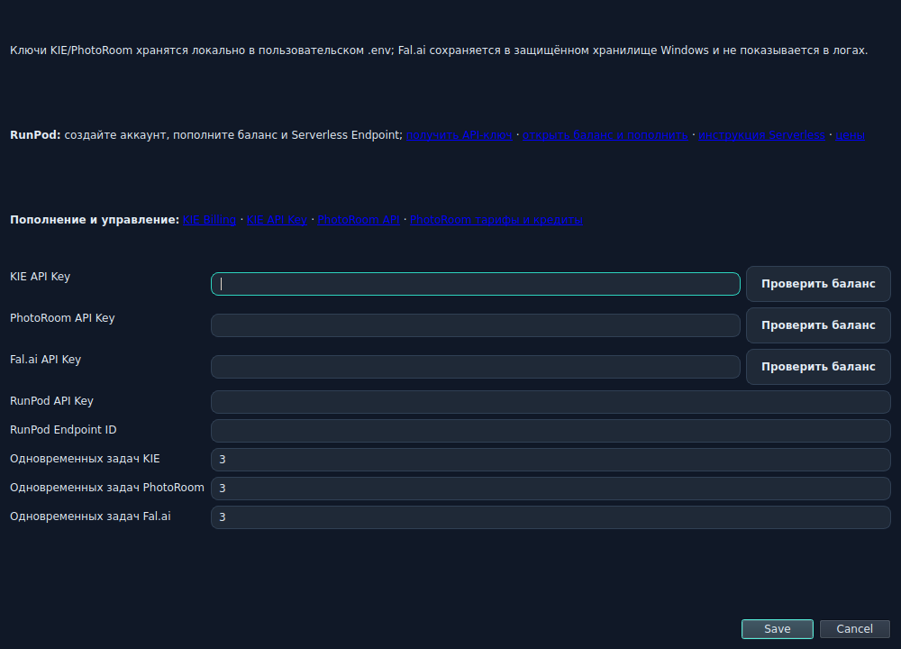

Локальные операции **Local rembg**, **Local Real-ESRGAN** и **Local Chroma Key** не требуют ключа. Приложение запросит KIE, fal.ai или PhotoRoom только тогда, когда выбран этап соответствующего провайдера.

### 3.6 Безопасность и расходы

- Создавайте отдельный ключ для Vibix Images: его можно отозвать независимо от других программ.
- Не отправляйте ключи в чатах, письмах, скриншотах и диагностических архивах.
- Не вставляйте префиксы `Bearer` или `Key` в поле приложения.
- Перед большой серией проверьте баланс, текущую цену и расчёт на экране запуска.
- Если ключ мог попасть постороннему, отзовите его в кабинете провайдера и создайте новый.
- Удаление Vibix Images не отменяет подписку провайдера.

## 4. Рабочие папки и результаты

Для каждого проекта выбирайте отдельную папку, например:

```text
Pictures/Vibix Images/Лесные звери/
```

Выбранная папка является корнем рабочего пространства. Vibix Images автоматически отделяет готовые файлы от промежуточных. При обработке исходники не перезаписываются, пока пользователь явно не включит **Перезаписывать существующие файлы**.

Практичная структура:

```text
Лесные звери/
  references/       референсы пользователя
  csv/              таблицы промптов пользователя
  source/           исходные изображения пользователя
  rough/            сохранённые промежуточные этапы и alpha-маски
  output/           готовые файлы с окончанием _ready.png
  .run/             временные данные отдельного запуска
```

Папка `.run/` служебная и обычно очищается после завершения. Если имя готового файла уже занято, приложение добавляет безопасный числовой суффикс и не перезаписывает результат молча.

Не выбирайте системную папку, корень диска или папку только для чтения. Для важных изображений работайте с копиями.

## 5. Режим Clipart: полный процесс

Основной маршрут Clipart состоит из семи этапов: **Рабочая папка → Промпты → Проверка промптов → Генерация → Обработка → Проверка и запуск → Результаты**. После успешного запуска доступен восьмой рабочий экран — **Проверка прозрачности**.

### 5.1 Рабочая папка

Выберите папку проекта. В ней должны быть разрешены создание и изменение файлов. Приложение запомнит выбранный путь в черновике.

### 5.2 Три способа добавить промпты

На экране **Содержание** доступны:

1. **Сгенерировать серию** — собрать много согласованных промптов из полей.
2. **Вставить готовый промпт** — добавить один многострочный промпт и до пяти референсов.
3. **Импортировать CSV** — загрузить таблицу с десятками или сотнями строк.

Новые данные добавляются к текущей серии. На следующем экране можно изменить текст, порядок и референсы.

## 6. Генератор промптов

Генератор создаёт комбинации **каждый объект × каждый вариант**. Три объекта и два варианта дают шесть промптов. Скрытые требования не добавляются: итог строится только из видимых заполненных полей.

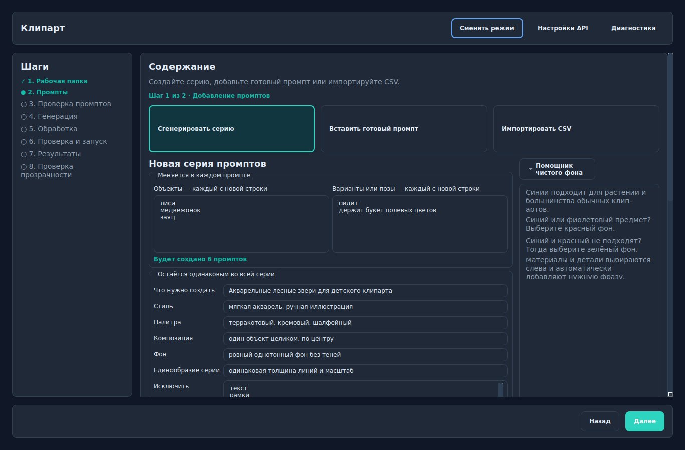

### 6.1 Поля генератора

| Поле | Что писать | Пример |
| --- | --- | --- |
| Что нужно создать | Общая тема и тип изображения | Акварельные лесные звери для детского клипарта |
| Объекты | Один объект на строку | лиса; медвежонок; заяц |
| Варианты или позы | Одна поза или ситуация на строку | сидит; держит букет |
| Стиль | Техника и визуальный характер | мягкая акварель, ручная иллюстрация |
| Палитра | Главные цвета | терракотовый, кремовый, шалфейный |
| Композиция | Положение и кадрирование | один объект целиком, по центру |
| Фон | Требуемый фон | ровный однотонный фон без теней |
| Единообразие серии | Что сохраняется одинаковым | одинаковая толщина линий и масштаб |
| Исключить | Нежелательные элементы, по одному на строку | текст; рамки; водяные знаки |

Сначала посмотрите предпросмотр и строку **Будет создано N промптов**. Затем нажмите **Создать серию промптов**.

### 6.2 Сильный шаблон клипарт-промпта

Хороший промпт отвечает на шесть вопросов: что изображено, в каком стиле, в какой палитре, как расположено, какой нужен фон и чего не должно быть.

```text
Watercolor baby fox sitting with a small wildflower bouquet,
soft hand-painted children's clipart, terracotta and sage palette,
one complete centered object, all ears and paws visible,
clean even background, no cast shadow,
no text, no frame, no watermark, no cropped parts.
```

Избегайте противоречий вроде «белый фон» и «прозрачный фон» одновременно. Генератор изображения обычно создаёт пиксельный фон; настоящая прозрачность появляется после этапа удаления фона.

### 6.3 Референсы

Референс помогает сохранить персонажа, позу, палитру или стиль. Для одного промпта можно добавить до пяти изображений.

- Используйте PNG, JPEG или WEBP.
- Один локальный референс должен быть не больше 10 МБ.
- Не добавляйте нерелевантные изображения: они ослабляют следование тексту.
- Промпты с референсами и без них могут использовать разные модели.
- Используйте только собственные или лицензированные изображения.

## 7. CSV: формат и импорт

CSV удобен для больших серий. Файл может быть в UTF-8, UTF-8 with BOM или Windows-1251. Поддерживаются разделители: запятая, точка с запятой, TAB и вертикальная черта. Размер файла ограничен 2 МБ.

### 7.1 Минимальный CSV

```csv
prompt
"Watercolor baby fox, isolated clipart, centered"
"Watercolor baby bear with flowers, isolated clipart"
```

### 7.2 CSV с референсами

```csv
prompt,references
"Watercolor baby fox, isolated clipart","C:\References\fox.png"
"Watercolor baby bear with flowers","C:\References\bear-front.png | C:\References\bear-pose.png"
"Watercolor rabbit, soft natural palette","https://example.com/licensed-rabbit.png"
```

Внутри колонки `references` несколько путей разделяются символом `|`. Максимум — пять референсов на строку. Если в тексте промпта есть запятые, заключите ячейку в двойные кавычки.

### 7.3 Как импортировать

1. Нажмите **Импортировать CSV** или перетащите файл в область импорта.
2. Оставьте **Разделитель: Авто**. Если распознавание неверно, выберите разделитель вручную.
3. Укажите колонку с промптом.
4. Выберите колонку с референсами или **Без референсов**.
5. Если первая строка содержит названия колонок, оставьте включённым **Первая строка — заголовки**.
6. Проверьте первые три строки и число ошибок.
7. Нажмите **Импортировать промпты**.

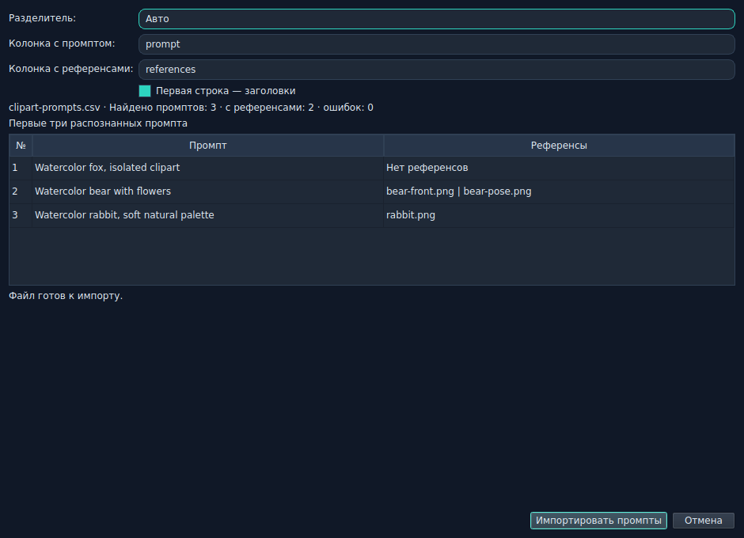

Пустой промпт, слишком длинное значение или более пяти референсов помечаются номером строки и не импортируются. Названия колонок могут быть любыми: нужные столбцы выбираются в окне. На экране проверки кнопка **Экспорт CSV** сохраняет текущую таблицу в совместимом формате `Prompt,References` с кодировкой UTF-8 BOM.

## 8. Проверка промптов

На втором этапе можно найти, отредактировать, продублировать, переместить и удалить строки, а также добавить, заменить или удалить референсы. **Найти и заменить** выполняет одну пакетную правку только для выбранных строк: замену текста, добавление в начало или в конец. Результат этой операции можно отменить отдельной кнопкой до следующего ручного изменения.

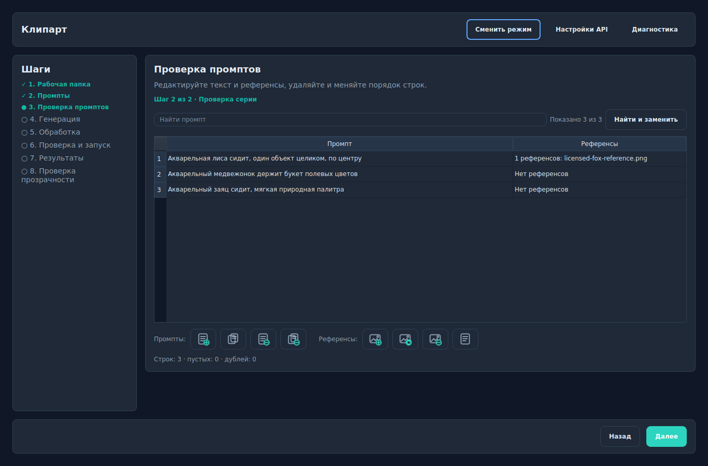

Перед продолжением проверьте:

- нет ли пустых и дублирующихся строк;
- одинаковы ли стиль, масштаб и фон во всей серии;
- не обрезаются ли важные части объекта по формулировке;
- существуют ли локальные файлы референсов;
- нет ли в промптах чужих товарных знаков или нелицензированных персонажей.

## 9. Chroma key: генерация на ключевом фоне

Chroma key — локальный и бесплатный способ получить прозрачность, если объект сгенерирован на ровном цветном фоне.

### 9.1 Подготовка промпта

1. В генераторе или под готовым промптом включите **Генерировать на однотонном chroma-key фоне**.
2. Нажмите одну из трёх кнопок цвета. Пользовательский HEX в версии 3.1.0 не используется:
   - синий — основной вариант для большинства объектов;
   - красный — для синих и фиолетовых объектов;
   - зелёный — если предмет не содержит зелёных деталей.
3. При необходимости выберите до трёх типов материала: **Акварель**, **Тонкие листья**, **Хвоя**, **Металл**, **Лента / сатин**, **Прозрачные детали** или **Снег / лёд**. Приложение добавит к промпту подходящие требования по краям и фактуре.
4. Не просите тени, градиенты, бумажную текстуру или сложный фон.
5. После создания серии приложение автоматически выбирает **Local Chroma Key** для удаления фона.

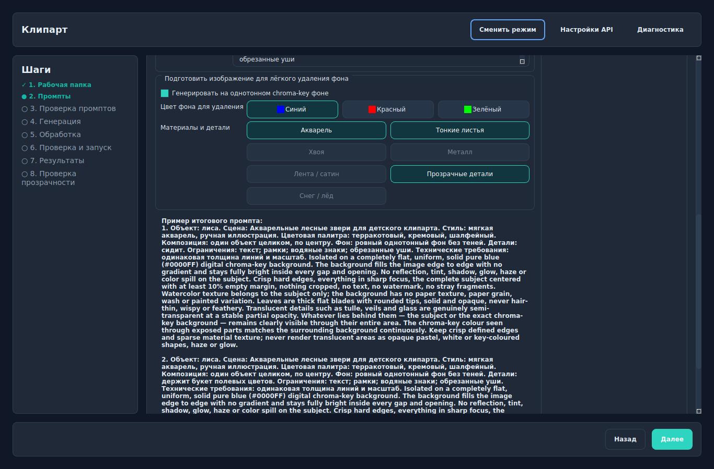

### 9.2 Параметры удаления

На этапе обработки включите **Удалить фон**, выберите **Local Chroma Key** и тот же цвет, который использовался в промпте. Алгоритм 3.1.0 сам измеряет фактический цвет по краям, строит маску, удаляет цветовой spill и старается сохранить отверстия, тонкие и полупрозрачные детали. Ручных полей **Допуск** и **Мягкость** в интерфейсе 3.1.0 нет.

Если фон неоднородный, выбран не тот цвет или точный key-цвет находится внутри предмета, обработка должна остановиться с понятным предупреждением вместо молчаливого повреждения. Выберите другой из трёх цветов и перегенерируйте исходник. Для остаточной каймы после успешного удаления включите **Очистить край alpha** на 1 px.

Chroma key работает локально, не требует API-ключа и не применяется в режиме Pinterest.

## 10. Модель, формат и число вариантов

На экране **Генерация** выберите модель, пропорцию, разрешение и количество вариантов на один промпт.

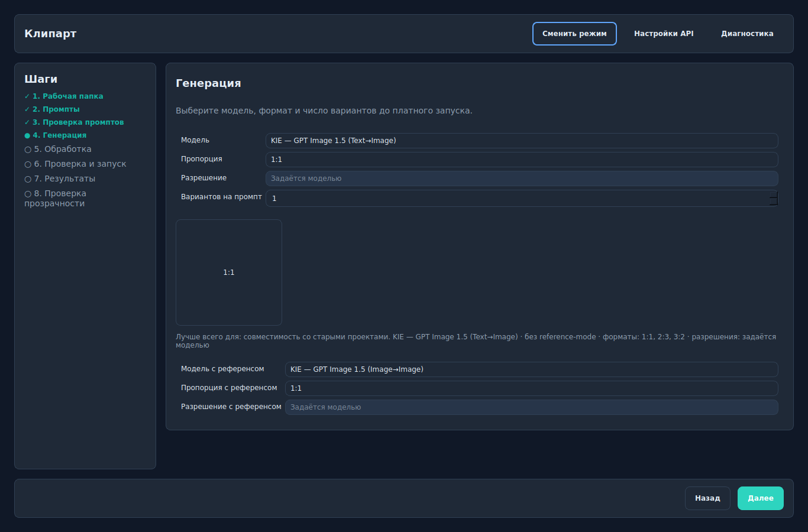

- Для обычного клипарта начните с `1:1` и одного варианта.
- Для строк без референсов используются основные **Модель**, **Пропорция** и **Разрешение**.
- Если в серии есть референсы, приложение показывает отдельные **Модель с референсом**, **Пропорция с референсом** и **Разрешение с референсом**. Списки содержат только совместимые значения выбранной модели.
- **Вариантов на промпт** остаётся общим для обеих групп.
- Чем больше промптов, вариантов и сетевых этапов, тем больше платных вызовов.
- Не все модели поддерживают все пропорции, разрешения и прозрачные входы; интерфейс показывает только совместимые значения.

## 11. Обработка клипартов

Операции выполняются сверху вниз. Можно сгенерировать изображения без обработки, обработать их после генерации или использовать режим Processing для уже готовых файлов.

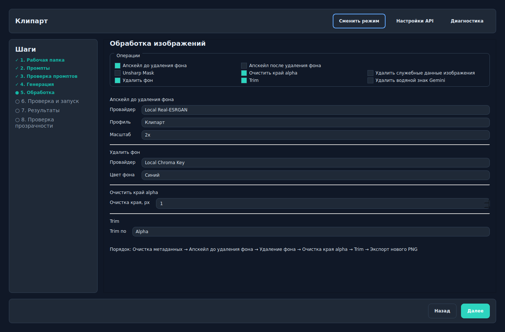

### 11.1 Этапы

| Этап | Что делает | Когда включать |
| --- | --- | --- |
| Апскейл до удаления фона | Увеличивает непрозрачное изображение | Нужна более точная маска или большой итоговый размер |
| Unsharp Mask | Усиливает локальный контраст краёв | Изображение выглядит мягким после апскейла |
| Удалить фон | Создаёт alpha-канал | Нужен прозрачный PNG |
| Апскейл после удаления фона | Увеличивает готовый прозрачный PNG | Выбранный провайдер сохраняет alpha |
| Очистить край alpha | Уменьшает цветную кайму на 1–3 px | После удаления фона остался ореол |
| Trim | Обрезает пустые поля | Нужен плотный клипарт без лишних отступов |
| 300 DPI | Записывает печатное разрешение | Файл готовится для печати; размер в пикселях сам по себе не меняется |
| Удалить служебные данные изображения | Очищает применимые служебные метаданные | Перед публикацией или продажей |
| Удалить водяной знак Gemini | Выполняет отдельную видимую операцию очистки | Только когда она действительно нужна |

### 11.2 Провайдеры удаления фона

| Провайдер | Ключ/сеть | Сильная сторона | Ограничение |
| --- | --- | --- | --- |
| Local Chroma Key | Нет | Быстро, предсказуемо и бесплатно на ровном цвете | Требует правильно сгенерированный однотонный фон |
| Local rembg | Нет после загрузки модели | Универсальная локальная обработка | Первый запуск загружает модель; качество зависит от типа изображения |
| KIE Recraft | KIE, сеть и оплата | Удобный облачный путь | Файл передаётся внешнему сервису |
| fal.ai Bria/BiRefNet/Ideogram/Pixelcut/rembg | fal.ai, сеть и оплата | Несколько профилей под разные сюжеты | Цена и параметры зависят от endpoint |
| PhotoRoom | PhotoRoom, сеть и оплата | Сильное удаление фона для фото и товаров | Отдельный API-тариф |

Для **fal.ai BiRefNet v2** начните с `General Use (Light)`. Для волос и мягких краёв попробуйте `Matting`, для портретов — `Portrait`, для сложных объектов — `General Use (Heavy)`. Сравнивайте на одном и том же небольшом наборе.

### 11.3 Рекомендуемые рецепты

**Клипарт на chroma-key фоне:**

```text
Local Real-ESRGAN 2x → Local Chroma Key → Очистка края 1 px → Trim → PNG
```

**Клипарт на обычном фоне:**

```text
Local rembg (профиль Клипарт) → Очистка края 1 px → Trim → PNG
```

**Фото товара:**

```text
PhotoRoom или fal.ai BiRefNet → визуальная проверка края → Trim при необходимости
```

Не включайте два апскейла без расчёта. `2x` до фона и `2x` после дают итоговые `4x`; `4x` и `4x` дают `16x`, большой файл и более высокую стоимость.

## 12. Проверка стоимости и запуск

Экран **Проверка и запуск** — последний защитный этап перед сетевыми и платными действиями.

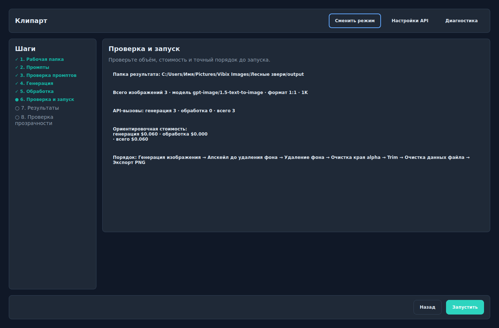

Проверьте пять строк:

1. **Папка результата** — куда будут записаны файлы.
2. **Всего изображений** — промпты × варианты.
3. **API-вызовы** — генерация плюс каждый выбранный сетевой этап обработки.
4. **Ориентировочная стоимость** — расчёт по известным тарифам; финальное списание определяет провайдер.
5. **Порядок** — фактическая последовательность операций.

Для fal.ai кнопка **Обновить оценку Fal.ai** показывается рядом со стоимостью. Обновление оценки необязательно и отдельной подтверждающей галочки в 3.1.0 нет. Если итог неожиданно велик, вернитесь назад и уменьшите число вариантов или отключите лишние сетевые этапы.

## 13. Результаты и повторный запуск

На странице результатов отображается очередь: ожидание, активная операция, готовый файл или ошибка. Не запускайте новый режим, пока текущая очередь активна.

- **Остановить после текущего** завершает уже принятую задачу и не отправляет новые.
- **Повторить ошибки** создаёт повтор только для неудачных элементов.
- Путь результата открывает папку готовых файлов.
- Для успешного PNG кнопка **Проверить прозрачность** открывает редактор; двойной щелчок по готовой строке делает то же самое.
- Диагностика показывает безопасные этапы и ошибки без API-ключей и полного текста промпта.

После завершения проверьте PNG на шахматном, белом, чёрном и ярком фоне. Белая кайма часто незаметна на белом, но проявляется на тёмном.

## 14. Редактирование прозрачности

В версии 3.1.0 редактор alpha-маски входит в рабочий маршрут Clipart и Processing. На странице результатов выберите успешный PNG и нажмите **Проверить прозрачность** или дважды щёлкните по строке. Редактор показывает только успешные PNG текущего запуска.

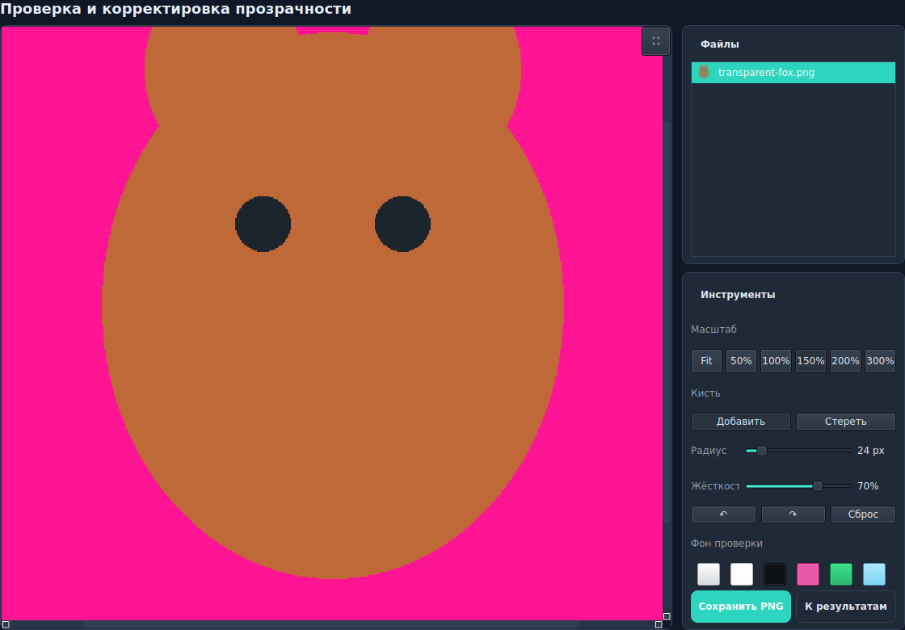

Работа в редакторе:

1. Выберите контрастный **Фон проверки**: шахматный, чёрный, белый, зелёный, ярко-розовый или светло-голубой.
2. Используйте **Fit**, `50%`, `100%`, `150%`, `200%` или `300%`. Удерживайте `Пробел` и перетаскивайте изображение для панорамирования; кнопка `⛶` разворачивает холст.
3. **Добавить** возвращает непрозрачность там, где фон был удалён лишне.
4. **Стереть** делает прозрачными оставшиеся куски фона.
5. Настройте **Радиус** кисти: крупный для больших областей, маленький для усов, волос и тонких деталей.
6. Настройте **Жёсткость**: меньшее значение даёт мягкий полупрозрачный край, большее — резкий.
7. Используйте `Ctrl+Z`, кнопки отмены/повтора или **Сброс**, чтобы вернуться к исходной маске.
8. Нажмите **Сохранить PNG**. Исправленный готовый PNG остаётся в `output/`, а согласованная alpha-маска сохраняется в `rough/`.
9. **К результатам** возвращает к очереди. При переключении файлов несохранённая маска сохраняется как черновик внутри текущего сеанса; при выходе приложение предупреждает о несохранённых изменениях.

Редактор меняет только alpha-канал, а не RGB-цвета объекта. Максимальный размер для открытия — 40 мегапикселей; более крупное изображение сначала уменьшите.

### 14.1 Если кисти недостаточно

- Перегенерируйте исходник на другом из трёх chroma-цветов и убедитесь, что фон ровный до самого края.
- Смените профиль Local rembg: **Клипарт**, **Люди**, **Аниме** или **Запасной**.
- Для цветной каймы включите **Очистить край alpha** на 1 px; повышайте до 2–3 px только после проверки тонких деталей.
- Для сложных волос сравните fal.ai BiRefNet `Matting` и PhotoRoom на одном тестовом изображении.
- Не редактируйте единственный оригинал: сохраняйте результат отдельным файлом.

## 15. Режим Pinterest

В версии 3.1.0 Pinterest — это упрощённый режим генерации вертикальных изображений по готовому промпту или CSV.

Текущий маршрут: **Рабочая папка → Промпты → Проверка промптов → Формат и модель → Проверка и запуск → Результаты**.

В режиме нет публикации в Pinterest, планировщика, SEO, аналитики, обязательного текста поверх, загрузки товара и постобработки изображения.

### 15.1 Добавление промптов

Можно вставить готовый многострочный промпт, добавить до пяти референсов или импортировать CSV по тем же правилам, что и в Clipart. Встроенного конструктора серии для Pinterest нет.

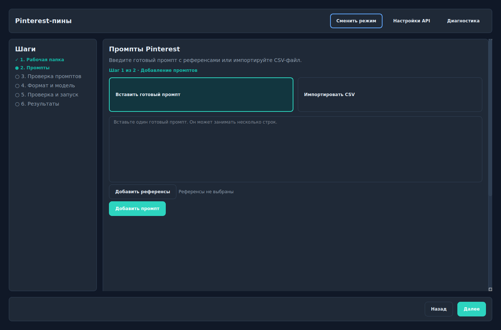

Пример:

```text
Vertical Pinterest image, cozy Scandinavian reading nook,
warm natural daylight, cream and sage palette,
editorial lifestyle photography, clean composition,
generous negative space in the upper third,
no text, no logo, no watermark, aspect ratio 2:3.
```

Если нужен текст на изображении, включайте его в промпт только для модели, которая хорошо воспроизводит надписи, и обязательно проверяйте орфографию результата. Само приложение не добавляет типографику поверх.

### 15.2 Формат и запуск

Рекомендуемая и исходная пропорция Pinterest — `2:3`. Фактический размер в пикселях определяют выбранная модель и значение разрешения (`1K`, `2K` и так далее), поэтому он не обязан быть ровно 1000×1500 px. Выберите одну модель и один вариант для теста, затем проверьте стоимость и запустите.

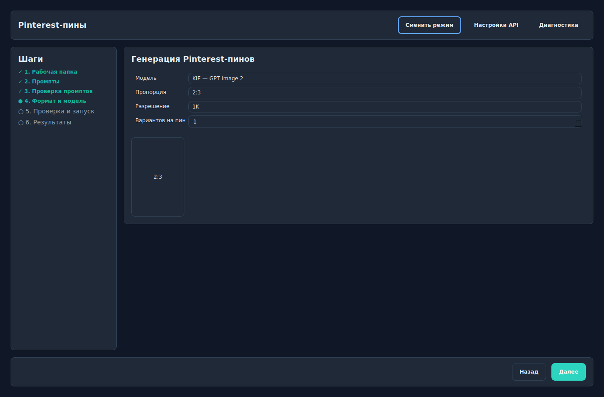

Chroma key, удаление фона, апскейл и редактор прозрачности в Pinterest не выполняются. Если результат нужно обработать, сохраните его и откройте отдельный режим **Обработать изображения**.

## 16. Режим Processing

Processing предназначен для собственных или лицензированных файлов, которые уже находятся на компьютере.

Основной маршрут: **Файлы → Цель обработки → Обработка изображений → Проверка и запуск → Результаты**. После успешного запуска доступна **Проверка прозрачности** тем же редактором, что и в Clipart.

### 16.1 Добавление файлов

Нажмите **Выбрать файлы** или перетащите изображения в область. Проверьте миниатюры, размер, DPI и папку результата.

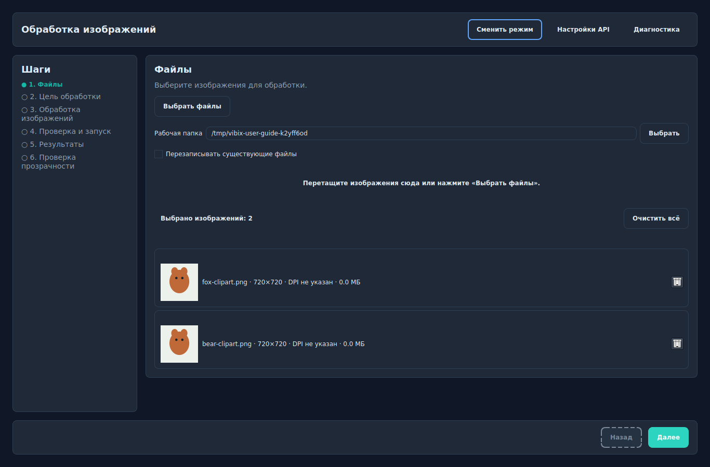

Флажок **Перезаписывать существующие файлы** по умолчанию выключен. Оставляйте его выключенным, пока не проверили рецепт на копиях.

### 16.2 Выбор цели

| Рецепт | Что включает |
| --- | --- |
| Базовое улучшение | Локальная резкость без сетевой передачи |
| Подготовить клипарт | Local rembg, очистка края и trim |
| Проверить и очистить | Удаление выбранных служебных метаданных с сохранением ICC и DPI |
| Свой рецепт | Ручной выбор всех этапов |

Рецепт только заполняет настройки. На следующем экране их можно изменить.

### 16.3 Настройка обработки

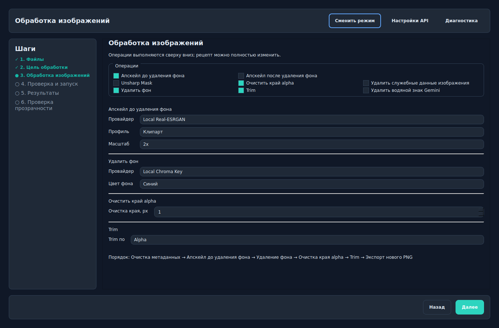

Выбирайте операции сверху вниз. Для локального рецепта используйте Local Real-ESRGAN, Local rembg или Local Chroma Key. Для KIE, fal.ai и PhotoRoom приложение покажет требуемый ключ и сетевую передачу на проверке запуска.

Если исходный PNG уже содержит полезную прозрачность, удаление фона может быть пропущено. Не запускайте remover повторно без необходимости: новая маска способна ухудшить тонкие края.

На странице результатов выберите успешный PNG и нажмите **Проверить прозрачность** или откройте его двойным щелчком. В редактор не попадают исходники, ошибки и результаты прежних запусков.

## 17. Практические сценарии

### 17.1 Серия клипартов для продажи

1. Создайте отдельную рабочую папку.
2. В генераторе задайте объекты, позы, единый стиль и ограничения.
3. Включите синий chroma key, если в объектах нет синего.
4. Проверьте все комбинации промптов.
5. Выберите квадратный формат и один тестовый вариант.
6. Включите Local Chroma Key, очистку края 1 px, trim, 300 DPI и очистку метаданных.
7. Запустите один тест, откройте **Проверить прозрачность** и проверьте края на тёмном и ярко-розовом фоне.
8. Только после проверки увеличьте серию.

### 17.2 Удалить фон у готовых изображений

1. Откройте **Обработать изображения**.
2. Добавьте копии исходников.
3. Выберите **Подготовить клипарт**.
4. Для иллюстраций начните с Local rembg, профиль **Клипарт**.
5. Оставьте очистку края 1 px и trim.
6. Проверьте папку результата и отсутствие сетевой передачи.
7. Запустите и сравните результат с исходником.

### 17.3 Pinterest с последующей обработкой

1. Создайте вертикальные изображения в режиме Pinterest.
2. Сохраните результаты.
3. Перейдите в **Обработать изображения**.
4. Добавьте выбранные Pinterest-файлы.
5. Выполните только необходимые этапы: резкость, метаданные или изменение фона.

## 18. Типичные проблемы

| Проблема | Причина | Что сделать |
| --- | --- | --- |
| Приложение просит API-ключ | Выбран сетевой провайдер | Добавить соответствующий ключ или выбрать локальную операцию |
| `401` / Unauthorized | Ключ неверный, отозван или вставлен с префиксом | Вставить чистый ключ, проверить его в кабинете |
| `402` / Insufficient Credits | Недостаточно средств | Пополнить баланс или выбрать локальный этап |
| `429` | Превышен лимит запросов | Уменьшить параллельность и повторить позже |
| CSV показывает неверные колонки | Неверно распознан разделитель или заголовок | Выбрать разделитель и колонки вручную |
| Референс не принимается | Файл недоступен, не изображение или больше 10 МБ | Проверить путь, формат и размер |
| Local Chroma Key остановился с предупреждением | Фон неоднородный, выбран не тот цвет или точный key-цвет есть в предмете | Выбрать другой из трёх цветов и перегенерировать на ровном фоне |
| После chroma key осталась кайма | Фон сгенерирован неравномерно или остался spill | Перегенерировать ровный фон; после успешного удаления попробовать очистку края 1 px и редактор прозрачности |
| Chroma key удалил часть объекта | Цвет объекта совпадает с выбранным key-цветом | Перегенерировать на другом цвете и при необходимости вернуть область кистью **Добавить** |
| После удаления фона потерялись волосы | Неподходящая модель или слишком жёсткая маска | Попробовать BiRefNet Matting, Portrait или PhotoRoom |
| Прозрачный PNG стал непрозрачным после апскейла | Выбран провайдер без поддержки alpha | Использовать Local Real-ESRGAN или совместимый KIE-путь |
| Результат слишком большой | Два апскейла перемножились | Проверить общий множитель на экране запуска |
| Первый Local rembg долго работает | Загружается модель | Дождаться загрузки; последующие запуски быстрее |

## 19. Чек-лист перед большой серией

- [ ] Выполнен один тестовый промпт и один вариант.
- [ ] Проверены пропорция, размер и модель.
- [ ] Цвет chroma key отсутствует в объекте.
- [ ] Все референсы принадлежат вам или лицензированы.
- [ ] Папка результата правильная, перезапись выключена.
- [ ] Число изображений и API-вызовов ожидаемое.
- [ ] Ориентировочная стоимость приемлема.
- [ ] Края PNG проверены на светлом, тёмном и ярком фоне.
- [ ] При необходимости исправленная маска сохранена кнопкой **Сохранить PNG**.
- [ ] Удаление метаданных не затрагивает нужные ICC и DPI.
- [ ] Исходники сохранены отдельно.

## 20. Официальные ссылки

- [KIE Getting Started](https://kie.ai/getting-started), [API Key](https://kie.ai/api-key), [Pricing](https://kie.ai/pricing)
- [fal.ai Authentication](https://fal.ai/docs/documentation/setting-up/authentication), [Dashboard Keys](https://fal.ai/dashboard/keys), [Models](https://fal.ai/models)
- [PhotoRoom API Documentation](https://docs.photoroom.com/), [API Dashboard](https://app.photoroom.com/api-dashboard), [API Pricing](https://www.photoroom.com/api/pricing)
- [RunPod API Keys](https://docs.runpod.io/get-started/api-keys), [Serverless Endpoints](https://docs.runpod.io/serverless/endpoints/overview)

Ссылки и интерфейсы внешних сервисов могут меняться. Если название кнопки отличается, ищите раздел **API Keys**, **Developer**, **Billing** или **Usage** в кабинете провайдера.
