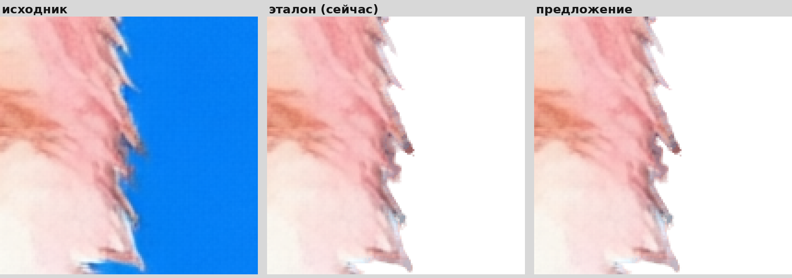
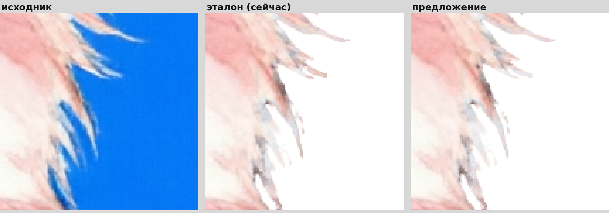
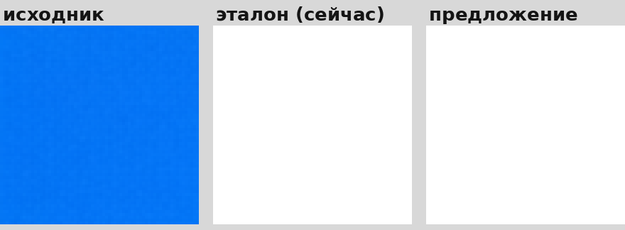
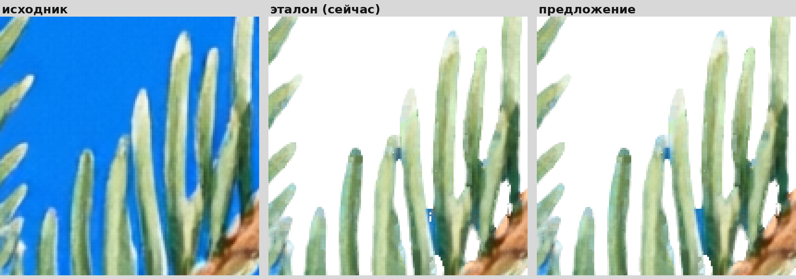
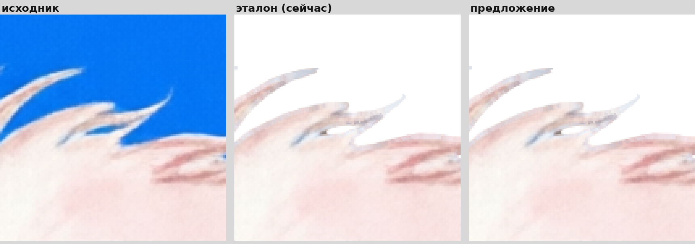

# Сравнение вариантов вырезки

Эталон: `/root/projects/Clipart Generator/fix-set-ok-only-20261029-worktree`
Предложение: `/root/projects/Clipart Generator/review-chroma-matting-20261029-worktree`

## rough_01_generated

| показатель | эталон | предложение | лучше/хуже |
|---|---|---|---|
| edge_w | 2.122 | 2.119 |  |
| jaggy | 8.907 | 8.922 | **хуже** |
| thin_kept | 81.98 | 82.02 | лучше |
| green | 0.09 | 0.09 |  |
| blue | 1.26 | 1.27 | **хуже** |
| detail | 254.07 | 254.07 |  |
| visible | 942333 | 942330 |  |

## rough_02_generated

| показатель | эталон | предложение | лучше/хуже |
|---|---|---|---|
| edge_w | 2.47 | 2.478 |  |
| jaggy | 9.943 | 9.95 | **хуже** |
| thin_kept | 69.73 | 69.77 | лучше |
| green | 0.04 | 0.04 |  |
| blue | 0.45 | 0.46 | **хуже** |
| detail | 253.99 | 253.99 |  |
| visible | 1039093 | 1039115 |  |

## rough_03_generated

| показатель | эталон | предложение | лучше/хуже |
|---|---|---|---|
| edge_w | 2.006 | 2.006 |  |
| jaggy | 8.142 | 8.142 |  |
| thin_kept | 77.74 | 77.74 |  |
| green | 0.12 | 0.12 |  |
| blue | 0.59 | 0.59 |  |
| detail | 254.44 | 254.44 |  |
| visible | 1125550 | 1125550 |  |

## rough_04_generated

| показатель | эталон | предложение | лучше/хуже |
|---|---|---|---|
| edge_w | 2.0 | 2.003 |  |
| jaggy | 8.673 | 8.659 | лучше |
| thin_kept | 78.46 | 78.51 | лучше |
| green | 0.42 | 0.4 | лучше |
| blue | 2.29 | 2.29 |  |
| detail | 254.2 | 254.2 |  |
| visible | 1174906 | 1174908 |  |

## rough_05_generated

| показатель | эталон | предложение | лучше/хуже |
|---|---|---|---|
| edge_w | 1.874 | 1.878 |  |
| jaggy | 8.946 | 8.939 | лучше |
| thin_kept | 74.74 | 74.76 | лучше |
| green | 0.06 | 0.06 |  |
| blue | 0.62 | 0.62 |  |
| detail | 254.52 | 254.52 |  |
| visible | 1397689 | 1397699 |  |

